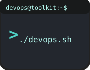
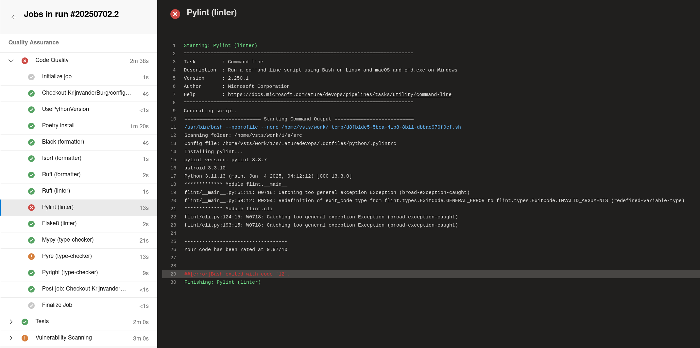

<p align="center">
  
</p>
<h1 align="center">zero-drift-devops-framework</h1>

<p align="center">
  <strong><em>Bridge the gap between local development and CI/CD with shared CLI and configuration</em></strong><br>
  Built by <strong>Krijn van der Burg</strong> for the DevOps community
</p>

<p align="center">
  <a href="https://github.com/KrijnvanderBurg/DevOps-Toolkit/stargazers">⭐ Star this repo</a> •
  <a href="https://github.com/KrijnvanderBurg/DevOps-Toolkit/issues">🐛 Report Issues</a> •
  <a href="https://github.com/KrijnvanderBurg/DevOps-Toolkit/discussions">💬 Join Discussions</a>
</p>

## 💡 What Makes This Different?

Many DevOps setups frustrate and fail because they treat local development and CI/CD as separate worlds. You format code locally with one tool, but the pipeline uses different configurations. You install dependencies one way in development, another in production. The result? **Misaligned local and CI/CD environments** with endless updating and debugging effort.

**This repository is an example implementation** that demonstrates a solution to this fundamental problem through a different architectural approach and repository structure: **perfect consistency everywhere**. It's not a tool or application itself, but rather a **working example** and **methodology showcase** that you can study, adapt, and copy for your own projects.

### 🎯 The Core Innovation: CI/CD Provider as Configuration Source of Truth

Instead of maintaining separate configurations for local and remote environments, this repository demonstrates a **CI/CD provider ownership** approach:

- **`.devcontainer/`** — Your local development environments with zero-configuration setup
- **`.github/`** — GitHub Actions workflows with configs in `.github/configs/`
- **`.azuredevops/`** — Multi-tier CI/CD pipeline templates with configs in `.azuredevops/configs/`

Each CI/CD provider maintains its own tool configurations (linters, formatters, security scanners, etc.) as the source of truth. DevContainers reference `.github/configs/` to match GitHub Actions locally, ensuring **exactly the same configuration files and CLI scripts** whether running locally or in GitHub Actions.

> **💡 Git Submodule Alternative:** While this repository uses a **monorepo approach**, the **git submodule pattern** (sharing a single `.dotfiles/` submodule across all environments) is equally valid and widely used. Choose based on whether you prefer:
> - **Monorepo**: Simpler management, per-provider flexibility, everything versioned together
> - **Submodules**: True single-source-of-truth, share configs across multiple repositories

### 🚀 What You'll Take Away

This **example repository** demonstrates a **proven approach** for restructuring DevOps workflows that bridges local and CI/CD environments through templating standardization. By studying and adapting this structure, you'll understand how to:

- **Architect consistency** across all environments using shared configuration and script submodules
- **Create predictable CI/CD outcomes** through identical local-remote tool execution
- **Scale DevOps practices** without losing quality or increasing complexity
- **Onboard teams quickly** with zero-configuration containerized environments

This isn't a tool to install—it's an **exploration and demonstration** of how modern DevOps consistency can be structured and work. **Copy what works, adapt what doesn't, and make it your own.**

> **🏗️ Architecture Note:** This repository demonstrates a **monorepo approach** with CI/CD providers (`.azuredevops/configs/`, `.github/configs/`) as configuration sources of truth. The **git submodule approach** (using a shared `.dotfiles/` submodule) is equally valid for teams wanting true single-source-of-truth across multiple repositories.

### 🎯 What You Can Copy & Adapt

✅ **20+ Pre-configured Development Tools** - Study how Ruff, Pylint, Mypy, Bandit, Pytest work together seamlessly
✅ **3 Specialized DevContainer Environments** - Copy and adapt Python/Spark development, distributed computing, infrastructure patterns
✅ **25+ Production-Ready Pipeline Templates** - Reuse atomic tools, composite workflows, complete CI/CD solutions in your projects
✅ **Zero Configuration Approach** - Learn the methodology that makes everything work out-of-the-box
✅ **Shared Local-Remote Consistency** - Implement the architecture that guarantees identical tool execution
✅ **Proven Repository Structure** - Apply the patterns tested in real development environments

> **🚀 Ready for hands-on examples?** The [Azure DevOps Templates README](https://github.com/KrijnvanderBurg/.azuredevops) contains extensive documentation with real pipeline examples, parameter guides, and composition patterns.

## 🌟 Why This Approach Changes Your Way of Working

### Instant Environment Setup
Specialized DevContainers for Python development (20+ code quality tools) with complete Apache Spark clusters launch in moments. Every tool pre-configured, every extension ready, every quality gate in CI/CD active locally with zero effort.


> **🔍 See every detail:** The [DevContainer documentation](https://github.com/KrijnvanderBurg/.devcontainer) shows you exactly how this works—from container configuration to tool integration, with complete examples you can run yourself.

### Multi-Tier Template Patterns
Atomic templates serve as idempotent building blocks that compose into higher-level workflows like `linter.yaml`. Switch underlying tools anytime—as long as parameters match, everything continues working. Share these templates across all repositories to eliminate setup fragmentation.

25+ Azure DevOps templates representing real-world patterns: code formatting, security scanning, dependency analysis, automated testing—all battle-tested and ready to adapt.



> **⚙️ Go deeper into templates:** The [Azure DevOps Templates README](https://github.com/KrijnvanderBurg/.azuredevops) has comprehensive guides on atomic template design and composition patterns.

### Perfect Local-Remote Consistency
The CI/CD provider configuration architecture means your DevContainer runs `ruff --config .github/configs/python/pyproject.toml` and your GitHub Actions run the exact same command with the same config file. This transforms CI/CD from an unpredictable feedback mechanism into a reliable quality gate— when local checks pass, you can be confident about remote execution.

**Ready to dive deeper?** Explore the Azure DevOps and GitHub configurations in `.azuredevops/configs/` and `.github/configs/` to see how this pattern works.

> **🛠️ Alternative Pattern:** Many teams use a **shared `.dotfiles/` git submodule** instead of per-provider configs. Both approaches achieve consistency - choose based on your versioning and repository structure preferences.


## 📚 Learn the Methodology

Master the architectural patterns through this comprehensive blog series:

- [📈 **Automatically Generate and Visualize Python Code Coverage in VSCode**](https://medium.com/@krijnvanderburg/automatically-generate-and-visualize-python-code-coverage-308e65627925)
    *Learn how I automated my Python code coverage in VSCode! Instantly visualize coverage data in the editor for faster, more efficient development.*

- [👮‍♂️ **How to enforce Code Quality standards using CI/CD**](https://krijnvanderburg.medium.com/enforce-code-quality-standards-using-cicd-c2b08d812550)
    *Learn how to enforce code quality standards with CI/CD pipelines for tools like Ruff, ensuring consistency and security in your software development.*

- [🤖 **DevContainers Mastered: Automating Manual Workflows with VSCode Tasks - Part 3/3**](https://krijnvanderburg.medium.com/how-i-automate-my-entire-ide-vscode-akin-to-cicd-992568ee7fb5)
    *Automate your local development workflows with VSCode tasks and DevContainers akin to CICD. Remove all manual forms testing, dependencies, and more!*

- [🛡️ **DevContainers Improved: Integrating Code Quality Checks for Continuous Feedback - Part 2/3**](https://krijnvanderburg.medium.com/add-code-quality-tools-in-your-ide-840df78c64d5)
    *Improve your workflow with DevContainers! Integrate code quality checks in VSCode for real-time feedback and error-free code. Boost productivity now!*

- [👨‍💻 **DevContainers Introduction: The Ideal Standardized Team Development Environment — Part 1/3**](https://krijnvanderburg.medium.com/devcontainers-the-ideal-standardised-team-dev-environment-zero-bs-2-7eb77f0cb4ee)
    *Discover how DevContainers streamline team workflows, ensure consistent environments, and automate setups for faster development and easier onboarding.*

- [🚀 **Distribute Tests with Pytest-Split for Faster CI/CD Execution**](https://krijnvanderburg.medium.com/how-to-distribute-tests-in-ci-cd-for-faster-execution-zero-bs-1-b86d4d69b19d)
    *Speed up your CI/CD with pytest-split! Learn how to distribute tests across agents for faster execution in Azure Pipelines and other platforms.*

- [⚡ **Local Multi-Node Spark Cluster in a DevContainer — Plug and Play**](https://medium.com/@krijnvanderburg/local-multi-node-spark-cluster-in-a-devcontainer-35f934e51308)
    *Learn how to set up a fully configured, multi-node Spark cluster locally using DevContainer with Docker Compose. Ready out-of-the-box for data engineering.*

- [🔒 **Dependency Lock Files are a Risk for End Users that You’re Ignoring**](https://medium.com/@krijnvanderburg/dependency-lock-files-are-a-risk-for-end-users-4d9b35b95e54)
    *Why dependency tools like Poetry and Pip hide real-world user issues and how building and installing your own package can uncover hidden problems.*

## 🚀 Explore This Example: Study and Adapt

This example repository demonstrates promising DevOps patterns. You can study the approach, copy what works for your projects, and adapt the methodology to your needs.

### Prerequisites
- [Docker Desktop](https://www.docker.com/products/docker-desktop/) and [VS Code](https://code.visualstudio.com/) with [Dev Containers extension](https://marketplace.visualstudio.com/items?itemName=ms-vscode-remote.remote-containers)
- [Azure DevOps account](https://azure.microsoft.com/en-us/products/devops/) (free with generous CI/CD minutes)

### Three Steps to Understanding

**1. Clone and Explore**
```bash
git clone https://github.com/KrijnvanderBurg/DevOps-Toolkit.git
cd DevOps-Toolkit
```
*This is a monorepo - all configs and templates are in the repository.*

**2. Experience Local Development with DevContainers**
- Open VS Code → `F1` → "Dev Containers: Rebuild and Reopen in Container"
- Choose your environment (Python development, Spark cluster, or infrastructure)
- Watch 20+ tools configure and run automatically
- Run linters, formatters, and tests locally - they use `.github/configs/` as source of truth
- All checks pass? You're ready to push!

**3. Commit, Push, and See CI/CD in Action**
- Make your changes, commit, and push to your repository
- Azure DevOps pipeline automatically runs using `.azuredevops/configs/` as source of truth
- GitHub Actions workflow runs using `.github/configs/` as source of truth
- Study how the same tools run remotely with CI/CD provider-specific configurations
- Browse `azure-pipelines.yml` and `.azuredevops/` templates to understand the patterns

### � Copy What You Need

**Ready to adapt these patterns?** Each component demonstrates approaches you can implement in your own projects:

- **[📦 DevContainers](.devcontainer/)** — Study the complete setup guides and tool configurations for building consistent local environments
- **[🔄 Azure DevOps Templates](.azuredevops/)** — Copy from 25+ templates with parameter guides and composition patterns for your CI/CD needs
- **[⚙️ GitHub Workflows](.github/workflows/)** — See workflow examples and reusable actions for GitHub Actions pipelines
- **[🗂️ Configurations](.azuredevops/configs/ & .github/configs/)** — Learn how CI/CD provider configurations work and adapt the tool-specific setup patterns

> **💡 Start here:** Begin with the [DevContainers](.devcontainer/) to see hands-on examples, then explore the [Azure DevOps Templates](.azuredevops/) to understand how everything connects.
